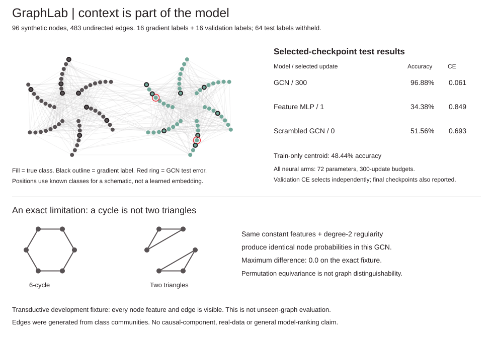
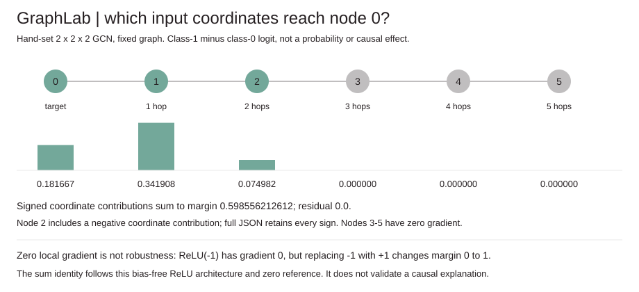

# GraphLab
## Joint deletion inspector: one edge at a time can miss the change

A new browser and CLI audit enumerates every original-edge subset up to a declared budget, recomputes all degree normalization and retains every target logit, class and signed margin effect. The residual separates the actual joint change from the sum of singleton changes. In a disclosed four-node control all five single deletions preserve class 1, but deleting e1/e3 changes class to 0 while singleton extrapolation still predicts class 1. The stronger minimum-margin pair remains visible. This is finite fixed-model sensitivity, not causal attribution or a formal robustness certificate.

51 Python tests retain the original 42. Separate dense/bitmask checks cover 180 seeded graph/model cases; 70-digit Decimal checks all 16 counterexample sets. Python/JavaScript agree on 46 complete reports and 559 subsets. Actual NumPy independently checks every target logit vector. Five Node/actual-Chrome tests cover 24 responsive views, 568 complete subset selections, six natively replayed trusted downloads and input invalidation. An isolated wheel exercises seven modules and all nine commands via both entrypoints. Original fits, scores and audit figures remain unchanged.

[Joint audit contract, commands, numerical evidence and source ledger](JOINT.md). The browser files in `docs/` can also be served locally without a prediction server. CI checks source, original demo figures, browser controls, the optional dense reference and an outside-checkout installed wheel.


**A graph neural network whose context, gradients and blind spots are visible.** Dependency-free two-layer graph convolution, masked node supervision, validation-only checkpoint selection and matched feature/topology controls.



## Run offline

```sh
python -m unittest discover -s tests -v
python -m graphlab demo > /tmp/graph-demo.json
python examples/render_demo.py /tmp/graph-demo.json --check
python -m graphlab train examples/train.json /tmp/model.json --updates 100
python -m graphlab predict /tmp/model.json examples/predict.json
python -m graphlab explain /tmp/model.json examples/predict.json --node 0 --positive 1 --negative 0
python -m graphlab attribution-demo > /tmp/input-audit.json
python examples/render_attribution.py /tmp/input-audit.json --check
```

Python 3.10+, standard library only. No downloaded graph, pretrained model, account, GPU, external dependency or paid API. The full demo takes about seven seconds on the development machine; runtime depends on hardware/Python.

## The model

For undirected binary adjacency A and added self loops:

```
S = D^(-1/2) (A + I) D^(-1/2)
H = ReLU(S X W0)
P = softmax(S H W1)
```

Sparse neighbor lists apply the symmetric normalized operator. It is **not row normalization**; irregular-graph row sums need not equal one. Isolated nodes retain their own features through a self loop. A feature-only MLP uses identity propagation with the same parameterization, initialization, parameter count and update budget.

Cross-entropy gradients use training nodes only. Validation labels can select a checkpoint, including initialization, but never enter the training gradient. Test labels are passed as `None` during fitting. Test **features and graph edges remain visible**: this is transductive node evaluation on one graph, not unseen-graph, unseen-node or temporal generalization. Prediction accepts only features/edges, never labels.

[DESIGN.md](DESIGN.md) records equations, masks, selection, bounds and strict artifacts.

## Measured development fixture

Seed 41: 96 nodes in two equal class communities, 4 noisy features, 483 edges. Each coordinate has class mean -0.25 or +0.25, noise SD 1. Edges are sampled with probability 0.2 within a class and 0.015 across classes. Thus **graph construction deliberately carries class signal**. Split: 8 training + 8 validation + 32 test nodes per class. The complete node lists are in demo JSON.

Each neural arm has 72 weights, shared seed 13, Adam learning rate 0.03 and 300 updates. Validation cross-entropy selects each arm independently among initialization and every update, with earliest ties retained. No test labels select a checkpoint. The scrambled graph uses seed 47 to relabel the same graph while keeping features/labels fixed: it preserves the graph's degree multiset and structure, not each original node's degree or feature alignment.

| Neural arm | Selected update | Selected train acc. | Selected validation acc. | Selected test acc. | Selected test CE | Last-update test acc. / CE |
| --- | ---: | ---: | ---: | ---: | ---: | ---: |
| GCN | 300 | 1.0000 | 1.0000 | 0.96875 | 0.060893 | 0.96875 / 0.060893 |
| Feature-only MLP | 1 | 0.6250 | 0.9375 | 0.34375 | 0.848734 | 0.484375 / 8.140771 |
| Scrambled-graph GCN | 0 | 0.3750 | 0.5625 | 0.515625 | 0.693328 | 0.546875 / 2.749939 |

A separate **train-only nearest-class-centroid** feature control fits 8 numbers with no validation selection and gives test accuracy **0.484375**. Balanced constant predictions give 0.5 on this balanced test set. The neural controls are not suppressed when a later checkpoint has higher test accuracy: both selected and last checkpoints are shown.

The feature MLP's excellent small-validation accuracy does not transfer to this test split; validation selection is no guarantee of representative evaluation. These are descriptive fixture results, not causal contributions or a general GCN ranking. Validation selection and the centroid control were added after inspecting the initial fixed-budget arms and their overfit losses. This is a **development fixture**, not an untouched benchmark or a multi-seed study. No architecture or seed sweep was run.

## Exact audits and an exact limitation

The original 42 tests cover every parameter of tiny reference models by finite differences in both modes, sparse-vs-dense forward arithmetic, independent degree normalization, permutation-equivariant predictions and training, mask isolation, stable unclipped cross-entropy, selection vs independent prefix refits, artifacts and CLI. Input-derivative tests add finite differences in both modes, exact two-hop support, permutation/margin reversal, zero-baseline sums, no mutation and the zero-gradient counterexample.

A six-cycle and two disconnected triangles are different graphs, but with identical constant node features and degree 2, every normalized neighborhood produces the same feature at every layer. This model gives **identical node probabilities** on both. The counterexample is exact for this architecture and fixture; it is not a claim that all graph neural networks fail on those graphs. No graph-level classifier or universal graph-isomorphism test is implemented.

## Fixed-model input gradients



`margin_attribution` / `explain` differentiates an explicit target node's chosen class-logit margin with respect to **all supplied input coordinates**, holding weights and graph fixed. It returns full signed gradient and gradient-times-input matrices, per-node sums, the margin, sum residual and the two-hop propagation receptive field. This is not a probability derivative or graph-edge attribution.

The hand-set tiny path fixture gives node contributions `[0.181666667, 0.341907943, 0.074981603, 0, 0, 0]`, summing to margin **0.5985562126120147** with reported residual **0.0**. Node 2's first coordinate contributes **-0.0136082763**, so only showing unsigned magnitudes would change the answer. Nodes 3-5 are beyond the two-layer receptive field and have exactly zero gradient; replacing node 5's features leaves the target margin unchanged. This is an arithmetic fixture, not a learned-model quality result.

For this **bias-free, positively homogeneous ReLU model** and the all-zero feature reference, the signed `x * gradient` sum equals the margin, up to floating-point reduction error. The identity is specific to this score/model/reference and is not an independent explanation-validity certificate. The zero reference need not be realistic. ReLU's derivative at exactly zero is defined as zero.

A separate one-node counterexample has margin ReLU(x): at x=-1 the gradient and `x * gradient` are both zero, yet replacing x with +1 changes the margin from 0 to 1. Local derivatives do not measure arbitrary finite interventions, causal importance, robustness or feature interactions. No new attribution method or causal claim is made.

## Edge deletion is a different question

`edge_sensitivity` / `edges` reruns the fixed model after deleting **each single original edge separately**, recomputing all degrees and normalization. It returns every signed margin change in original edge order. Features and weights stay fixed. This is finite score sensitivity, not an edge gradient, causal importance, joint-deletion guarantee or performance metric.

| Deleted edge in the hand-set path | Node-0 class-1 minus class-0 margin | Change from baseline |
| --- | ---: | ---: |
| None | 0.598556213 | 0 |
| 0-1 | 0.742000000 | +0.143443787 |
| 1-2 | 0.720500000 | +0.121943787 |
| 2-3 | 0.615407943 | +0.016851731 |
| 3-4 | 0.598556213 | 0 |
| 4-5 | 0.598556213 | 0 |

Node 3's **input-feature derivative is zero**, yet deleting edge 2-3 changes the target margin because node 2's degree changes. Input-feature locality does not imply the same boundary for graph structure or normalization. Deletions 3-4 and 4-5 have no effect in this tiny fixture. No statement of generic edge irrelevance follows from a zero single-deletion effect.

A preflight budget requires `1 + number_of_edges` model forwards before any model call. Default cap 256, supported cap 1-8193. The five-edge demo takes exactly six forwards. No partial top-k list hides edges, and an over-budget request fails rather than silently sampling. Every perturbed graph still adds self loops, so isolated nodes remain valid. This can be expensive on larger graphs; counts are actual forward invocations, not walltime claims.

```sh
python -m graphlab edge-demo
python -m graphlab edges /tmp/model.json examples/predict.json --node 0 --positive 1 --negative 0 --max-forwards 256
```

## Scope and limits

Small, undirected, unweighted graphs only: 1-128 nodes, 1-16 features, hidden width 1-32 and 2-8 classes. No edge features, attention, graph-level pooling, minibatching, dropout, weight decay, gradient clipping, calibration or confidence guarantee. The original paper's full training recipe and citation-network benchmarks are **not** reproduced. The figure's positions use true classes for a disclosed schematic, not a learned embedding.

Inference artifacts store weights and architecture, not graph data or optimizer state. No private/customer data is used and there is no privacy guarantee. This is an educational implementation, not a production library.

## Source credit

Independent educational implementation of **Kipf and Welling (2017), [Semi-Supervised Classification with Graph Convolutional Networks](https://arxiv.org/html/1609.02907v4)**, especially normalized propagation Eq. 2 and the two-layer model/masked cross-entropy Eq. 9-10. Source read for mathematics; no copied code, dataset or pretrained weights. Published benchmark results belong to the paper, not this project.

MIT license.
